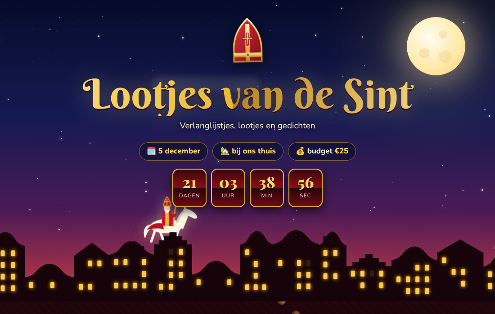

# 🎁 Lootjes van de Sint

Een kleine, privé lootjessite voor Sinterklaas in volle Sinterklaasstijl, voor je familie of vriendengroep.



**In het kort:** fork deze repo → importeer hem in Vercel → koppel een private Blob store → zet je Resend-key erin → vul namen in op de beheerpagina. Klaar.

- **Persoonlijke links**: geen accounts of wachtwoorden; iedereen krijgt een geheime link per mail.
- **Verlanglijstjes** met per wens een link en een notitie, plus een algemene notitie.
- **Automatische trekking** zodra iedereen zijn lijstje klaar heeft. Niemand trekt zichzelf.
- **Echt geheim**: alleen jij ziet wie jij hebt. De beheerpagina toont alleen wie er klaar is, nooit wie wie heeft of wat iemand wenst. (De beheerder kan wel ieders persoonlijke link kopiëren om via WhatsApp te delen, en moet die links dus zelf niet openen.)
- **Alleen jouw Sint ziet jouw lijstje**: je verlanglijstje is alleen zichtbaar voor degene die jou getrokken heeft.
- **Mails** via [Resend](https://resend.com): uitnodiging, herinnering, en "je lootje is getrokken".
- **Gedichtenhulp**: vul een paar woorden in en de Sint rijmt een gedicht.
- **WhatsApp**: de beheerpagina kopieert per deelnemer een berichtje met de persoonlijke link.
- Een nachthemel met de Sint te paard over de daken, aftelklok, vallende pepernoten, een envelop met lakzegel en confetti bij het openen.

Geen framework, geen build-stap: statische HTML/CSS/JS in `public/` en drie kleine serverless functies in `api/`. Opslag is één privé JSON-bestand in Vercel Blob.

## Zelf online zetten (± 15 minuten)

1. **Fork of kopieer** deze repository naar je eigen GitHub.
2. **Vercel**: *Add New → Project*, kies je repository, klik *Deploy*. (Framework: "Other", niets aanpassen.)
3. **Opslag**: in je Vercel-project *Storage → Create → Blob*, kies **Private** en koppel hem aan het project. Dit zet `BLOB_READ_WRITE_TOKEN` automatisch.
4. **Mail**: maak bij [Resend](https://resend.com) een API-key en verifieer je eigen domein (zonder eigen domein mag Resend alleen naar je eigen adres mailen).
5. **Environment variables** in Vercel (*Settings → Environment Variables*), zie [`.env.example`](.env.example): minimaal `ADMIN_KEY`, `RESEND_API_KEY` en `MAIL_FROM`, en naar wens de `EVENT_*`-variabelen.
6. **Redeploy** zodat de variabelen actief worden.
7. Open `https://<jouw-site>.vercel.app/beheer?k=<ADMIN_KEY>`, vul namen en mailadressen in en klik *Stuur uitnodiging naar iedereen*.

Daarna gaat alles vanzelf: iedereen vult zijn lijstje in, de laatste die op *Mijn lijstje is klaar* klikt start de trekking, en iedereen krijgt een mail.

## Je AI koppelen aan Vercel en Resend (MCP)

Met MCP kan je AI-assistent zelf in je Vercel- en Resend-account kijken: deployments en logs lezen, opnieuw deployen, je verzenddomein controleren. Dat scheelt heen-en-weer kopiëren. Het is optioneel; alles kan ook met de hand via de stappen hierboven.

**Claude (claude.ai, desktop of mobiel):** ga naar *Instellingen → Connectors*, voeg **Vercel** en **Resend** toe en log bij allebei in.

**Claude Code:**

```bash
claude mcp add --transport http vercel https://mcp.vercel.com
claude plugin install resend@claude-plugins-official
# daarna in Claude Code: /mcp  (om in te loggen)
```

**Andere assistenten (Cursor, VS Code met Copilot, Codex, …):** voeg deze twee servers toe als remote MCP-server en log in via de browser.

| Dienst | MCP-adres | Documentatie |
| --- | --- | --- |
| Vercel | `https://mcp.vercel.com` | [vercel.com/docs/agent-resources/vercel-mcp](https://vercel.com/docs/agent-resources/vercel-mcp) |
| Resend | `https://mcp.resend.com/mcp` | [resend.com/docs/mcp-server](https://resend.com/docs/mcp-server) |

Daarna kun je bijvoorbeeld vragen:

- "Kijk in Vercel of de laatste deploy van mijn lootjessite gelukt is en of de opslag werkt."
- "Controleer in Resend welk domein geverifieerd is en welk afzenderadres ik kan gebruiken."
- "Deploy de site opnieuw en lees de foutlogs als het misgaat."

**Wat bij ons wel en niet lukte via MCP** (kan per account en rechten verschillen): deployments bekijken, opnieuw deployen, de live site ophalen en het Resend-domein controleren ging prima. Een project aanmaken, environment variables zetten en een Blob store aanmaken werd geweigerd; dat zijn stap 2, 3 en 5 hierboven en die doe je in een paar klikken zelf in het Vercel-dashboard.

Zet je Resend API-key en je `ADMIN_KEY` alleen in Vercel, nooit in de code of in een openbare chat.

## Lokaal draaien

```bash
npm install
cp .env.example .env   # pas ADMIN_KEY aan; laat BLOB_READ_WRITE_TOKEN leeg
npm run dev            # http://localhost:3000/beheer?k=<ADMIN_KEY>
npm test               # controleert de trekking: niemand trekt zichzelf
```

Lokaal worden de gegevens bewaard in `.data/state.json`. Zonder `RESEND_API_KEY` worden de persoonlijke links in de terminal gelogd in plaats van gemaild.

## Bouwen met je eigen AI

Wil je de site aanpassen met een AI-assistent (Claude, ChatGPT, Copilot, …)? Geef hem deze repository en het bestand [`AGENTS.md`](AGENTS.md); daarin staat hoe alles in elkaar zit en welke regels je niet moet breken. Voorbeelden van vragen:

- "Voeg een verbodsregel toe zodat partners elkaar niet kunnen trekken."
- "Maak er een kerst-thema van met groen en goud."
- "Laat de gedichtenhulp een AI-model gebruiken in plaats van de sjablonen."

## Privacy, eerlijk gezegd

De site laat niemand zien wie wie getrokken heeft, ook de beheerder niet. Wel staat de trekking in het privé-opslagbestand in jouw Vercel-account; wie dat bestand opent kan het lezen. Open het dus niet als je zelf ook meedoet. Wie de beheersleutel heeft, kan ieders persoonlijke link kopiëren (bedoeld om via WhatsApp te delen) en zou daarmee andermans pagina kunnen openen. Het geheim blijft dus bewaard zolang de beheerder dat niet doet.

## Gemaakt door

Bedacht en gebouwd door [Matthijs Goes](https://matthijsgoes.nl), samen met [Claude](https://claude.com).

## Licentie

MIT. Veel plezier, en vergeet het gedicht niet!
